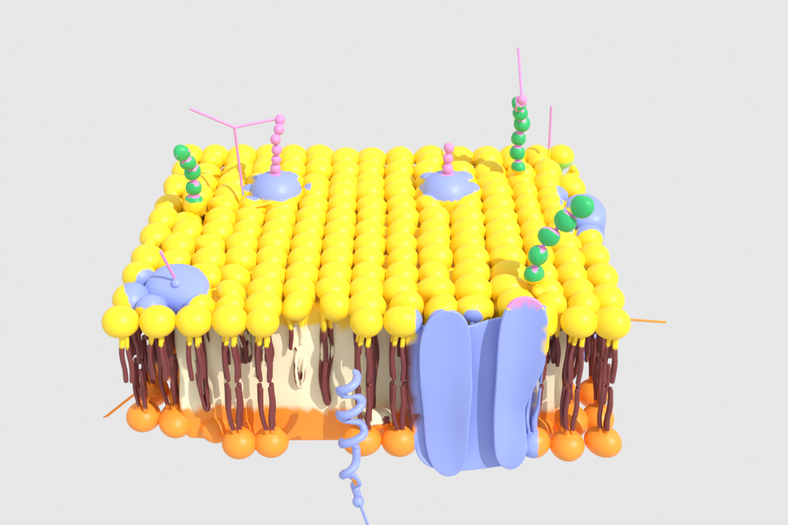
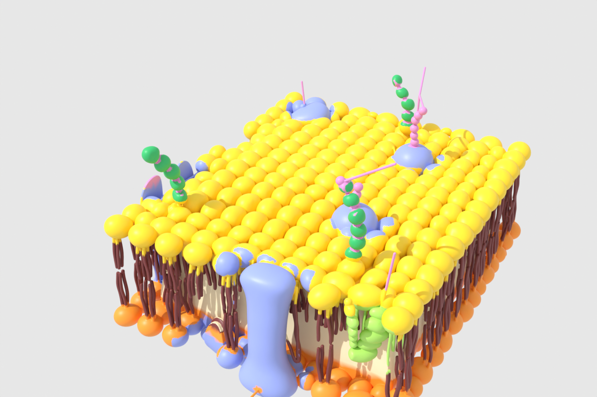

# 3D-Blender

Testes de modelagem e texturização no Blender feitos por script (Python + `bpy`).

## Teste 1: membrana plasmática colorida

O modelo original (`Membrana_plasmática_teste-textura.glb`) chegou todo branco: uma malha única
com 3,2 milhões de faces, sem UV e sem textura. O objetivo foi colori-lo seguindo a imagem de referência
(`input/membrana-plasmatica.jpg`).

| Frente | Lateral |
|---|---|
|  |  |

### Resultado (`output/`)

- `membrana_colorida.glb`: modelo com as cores gravadas nos vértices (atributo `COLOR_0`),
  reduzido para cerca de 958 mil faces (27 MB) para abrir rápido em visualizadores e na web.
- `membrana_colorida.blend`: o mesmo modelo, pronto para abrir no Blender.
- `render_frente.png`, `render_lateral.png`: renders de prévia feitos com o motor Cycles.

Cores usadas:

| Parte | Cor |
|---|---|
| Cabeças dos fosfolipídios (camada externa) | amarelo |
| Cabeças dos fosfolipídios (camada interna) | laranja |
| Caudas | marrom escuro |
| Proteínas (canal, integral, globular, periférica, alfa-hélice, glicoproteínas) | azul |
| Glicolipídios (cadeias de contas) | verde |
| Carboidratos (hastes finas) | rosa |
| Colesterol | verde-claro |
| Interior da bicamada | creme |

### Como funciona

Como a malha é praticamente uma peça só, não deu para separar as moléculas por partes.
Em vez disso, cada vértice é classificado por:

1. **Altura (z):** camada de cabeças de cima, camada de baixo, região das caudas, ou acima da membrana (carboidratos).
2. **Espessura local:** um raio lançado para dentro da superfície mede a espessura do objeto naquele ponto.
3. **Curvatura local:** o raio aproximado da superfície separa esferas (cabeças, cerca de 5 cm), tubos finos
   (caudas, cerca de 1 cm) e superfícies largas.
4. **Regiões das proteínas:** caixas e discos posicionados a partir de vistas de topo, frente e lateral.

Depois disso, os rótulos são suavizados pelos vizinhos da malha para tirar o ruído e gravados como cor de vértice.

### Scripts (`scripts/`)

Requisitos: Python 3.13 com `pip install bpy scipy numpy` (o pacote `bpy` é o próprio Blender 5.2 como módulo).

```bash
python scripts/glb_info.py input/membrana.glb             # lista objetos, materiais e texturas
python scripts/01_espessura.py input/membrana.glb tmp/thick.pkl
python scripts/02_curvatura.py tmp/thick.pkl input/membrana.glb tmp/feat.pkl
python scripts/03_colorir.py input/membrana.glb tmp/thick.pkl tmp/membrana_cor   # usa tmp/feat.pkl
python scripts/04_exportar.py tmp/membrana_cor.blend output/
```

As regras de cor ficam em `scripts/classify.py`. As coordenadas das proteínas valem só para este modelo.

O `.glb` original (77 MB) não está no repositório, por causa do tamanho. Ele está na pasta compartilhada do Google Drive.
